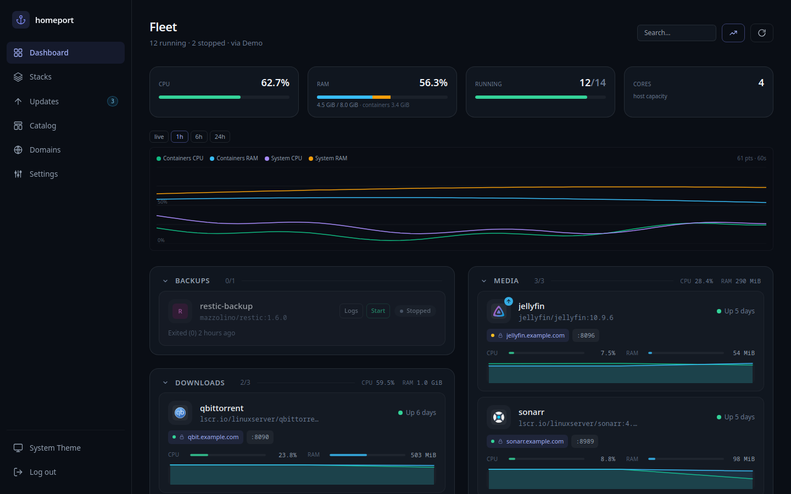
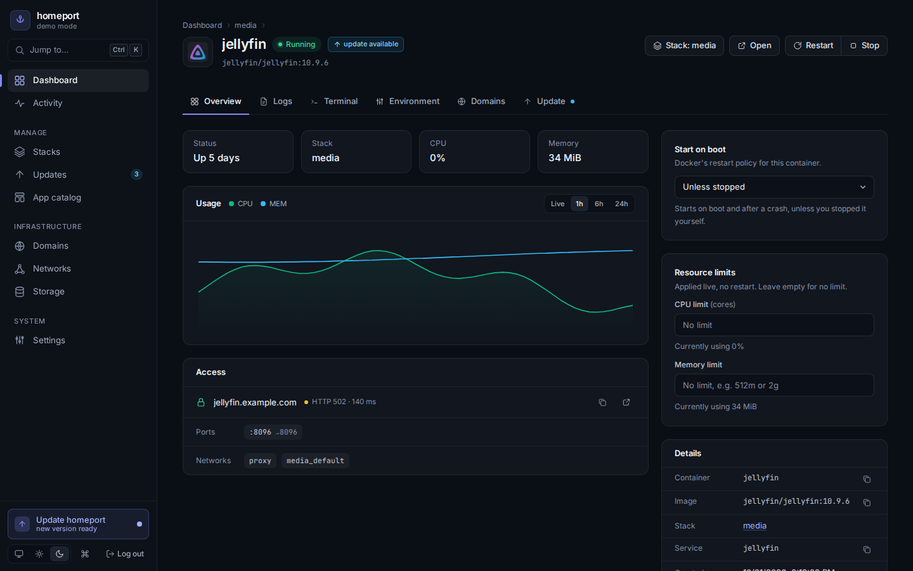
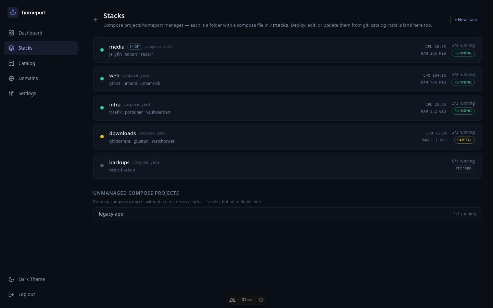
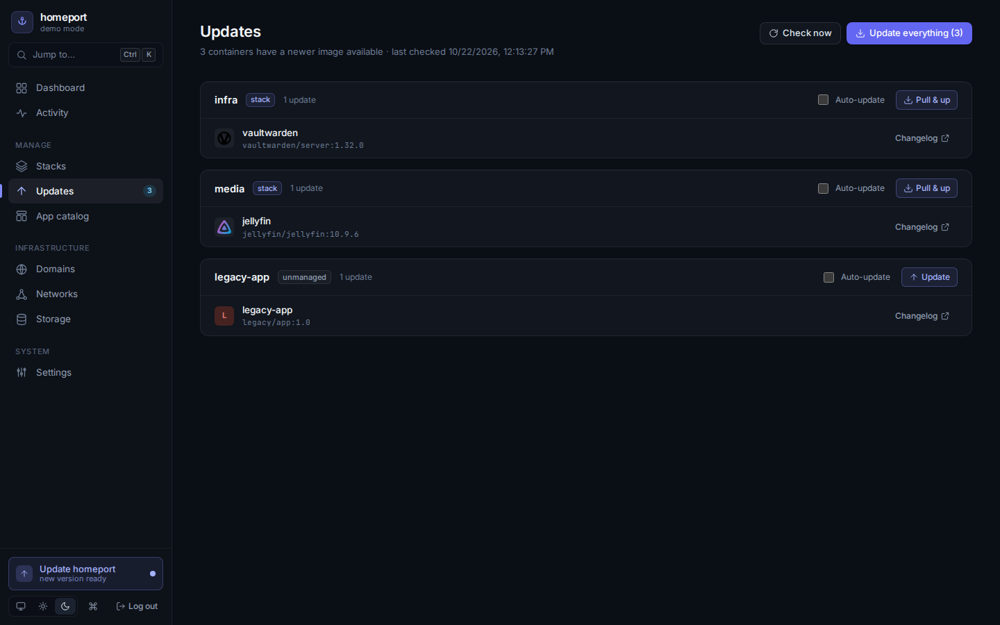

<div align="center">


# homeport

**A zero-config status hub for your self-hosted Docker fleet — no tiles to configure.**

[](https://github.com/JustinAlink/homeport/actions/workflows/ci.yml)
[](https://github.com/JustinAlink/homeport/releases)
[](https://github.com/JustinAlink/homeport/pkgs/container/homeport)
[](LICENSE)

Point it at your Docker socket and your reverse proxy — it builds the dashboard for you.
No tiles to configure: every container shows up automatically, with its status and the
domain that points to it.

[Quick start](#quick-start) · [Features](#why-homeport) · [Compare](#how-it-compares) · [Security](#security)

</div>



> Want to see it before wiring up Docker? Run it with `HOMEPORT_DEMO=true` for a
> synthetic fleet (the screenshot above is demo mode).

<details>
<summary><b>Table of contents</b></summary>

- [Why homeport?](#why-homeport)
- [How it compares](#how-it-compares)
- [Quick start](#quick-start)
- [Get your first service online](#get-your-first-service-online)
- [Configuration](#configuration)
- [Reverse-proxy support](#reverse-proxy-support)
- [Watch multiple hosts](#watch-multiple-hosts)
- [Manage domains (proxy admin)](#manage-domains-proxy-admin)
- [Compose stacks](#compose-stacks)
- [History & alerts](#history--alerts)
- [Updates & auto-update](#updates--auto-update)
- [Security](#security)
- [App catalog](#app-catalog)
- [Git-backed stacks](#git-backed-stacks)
- [Backup & restore](#backup--restore)
- [Support](#support)
- [License](#license)

</details>

## Why homeport?

If you self-host, you already know what's running — it's just scattered across `docker ps`, your
reverse-proxy admin, and a dashboard you hand-edit every time you add a service. homeport reads it
all live and builds the page for you. **Zero tiles to configure.**

### 🔎 Discover & monitor
- **Auto-discovery** — every container appears on its own: name, image, status, health, ports.
- **Automatic domains** — homeport reads your reverse proxy, so it already knows `webapp → app.example.com`.
- **Live** — updates the instant a container starts, stops, or goes unhealthy (Docker events, not polling).
- **Graphs & uptime** — per-container CPU/RAM sparklines, per-stack totals, and a fleet graph with a 1h/6h/24h range (containers vs. whole-machine, straight from procfs) — plus optional up/down pings.
- **Find anything fast**: <kbd>Ctrl</kbd>/<kbd>⌘</kbd>+<kbd>K</kbd> jumps to any container, stack or page and runs actions ("restart sonarr", "jelly logs"); <kbd>?</kbd> lists every shortcut. The dashboard filters by status, flags what needs attention, pins favourites to the top, and switches between cards and a dense list.
- **Alerts** — down / unhealthy / recovered over Discord, Slack, ntfy, Apprise (Gotify/Pushover/Telegram/…), custom webhooks, or email, with anti-flap debounce.

### 🛠️ Manage — opt-in, only what you enable
- **A page per container** — live logs, a **web terminal**, an **env editor** (secrets stay write-only), and one-click **image updates**.
- **Lifecycle controls** — start / stop / restart / recreate / delete (off by default).
- **Compose stacks** — edit the YAML in the browser (validated before it lands) and deploy / down / restart / pull with output streamed live.
- **Updates in one place** — every outdated image grouped by stack, with opt-in scheduled auto-updates.

### 🌐 Domains, proxy & apps
- **Proxy management** — create / edit / remove routes from the UI (Nginx Proxy Manager, Caddy, or Traefik).
- **App catalog** — one-click install curated + Portainer-compatible templates, plus **Docker Hub & GitHub** tabs that auto-dockerize any image or repo — including [a reverse proxy itself](#get-your-first-service-online).
- **Git-backed stacks** — deploy straight from a repo and update with one click when it moves.

_Plus real app logos, systemd services, multi-host aggregation, backup & restore, and an in-app settings page for all of it._

**Read-only out of the box** — every capability that writes is a separate opt-in you control. See [Security](#security).

## How it compares

Most self-hosted dashboards make you choose between *seeing* your fleet and *managing* it.
homeport is the overlap — it discovers everything on its own, reads your reverse proxy so it
already knows your domains, and stays read-only until you decide to turn management on.

| | **homeport** | Portainer | Dockge | Homepage / Dashy |
|---|---|---|---|---|
| Setup | **Zero-config** — auto-discovers every container | Manual | Point at compose dirs | Hand-write a tile per service |
| First job | Status hub (read-only by default) | Full management console | Compose editor | Static launcher |
| Domain mapping | **Automatic** — reads NPM / Caddy / Traefik / Nginx | — | — | Manual links |
| Live updates | Docker events (instant) | Polling | — | — |
| Management | **Opt-in, tiered** (controls · updates · stacks · terminal) | Always on | Compose ops | None |
| Compose stacks | ✅ edit + deploy in-browser | limited | ✅ (its focus) | — |
| Reverse-proxy admin | ✅ create/edit routes from the UI | — | — | — |

Coming from one of those? homeport isn't a replacement for a full container platform — it's the
status-and-domains layer on top, and it stays out of your way until you turn management on.

**Not (yet) for you if…**

- You need **native OIDC / OAuth SSO** — homeport supports **forward-auth** (put it behind
  Authelia / Authentik / oauth2-proxy and it trusts their `Remote-User` header) and **built-in
  TOTP 2FA** on the admin account, but there's no built-in OIDC yet.
- You run **Podman, Kubernetes, or Swarm** — homeport talks to the Docker API only.
- You want to edit a container's **healthcheck** from the UI — not there yet, and can't be live-updated
  by the Docker Engine API even if it were (needs a recreate). CPU/RAM limits, restart policy, and the
  full compose file can all be edited live.

Every container has its own page — overview, logs, terminal, domains, and updates:



## Quick start

**Try it in 30 seconds** (synthetic fleet, no Docker access needed):

```bash
docker run --rm -p 3004:3000 -e HOMEPORT_DEMO=true -e HOMEPORT_ADMIN_PASSWORD=demo \
  ghcr.io/justinalink/homeport:latest
# open http://localhost:3004  ·  log in with "demo"
```

**Install on a server — one command** (recommended). Installs Docker if it's missing,
creates the reverse-proxy network, fetches the hardened compose setup (read-only Docker
socket proxy), generates a session secret, and starts it:

```bash
curl -fsSL https://raw.githubusercontent.com/JustinAlink/homeport/main/install.sh | sh
# → prints a setup link with a one-time code: open it and create your admin password
```

Rather read the script before running it (a good habit for any `curl | sh`)?

```bash
curl -fsSLO https://raw.githubusercontent.com/JustinAlink/homeport/main/install.sh
less install.sh        # inspect it
sh install.sh
```

**Simplest — just point it at Docker** (raw socket, mounted read-only, no proxy):

```bash
docker run -d --name homeport -p 3004:3000 \
  -v /var/run/docker.sock:/var/run/docker.sock:ro \
  -v homeport-data:/data \
  ghcr.io/justinalink/homeport:latest
docker logs homeport 2>&1 | grep "setup code"   # the one-time setup code
# open http://<host>:3004, enter the code, create your admin password
```

> **For a quick local look only.** A `:ro` socket mount isn't a real security boundary — the
> Docker API is root-equivalent, so anything in the container could still control Docker. For a
> server (or anything exposed), use the one-command install above: it runs homeport behind a
> locked-down `docker-socket-proxy` that only exposes the calls it needs.

No env vars required: on first visit homeport walks you through **setting an admin
password** (and generates a session secret for you). To prove it's you and not whoever
finds a fresh install first, setup asks for a **one-time setup code** that homeport prints
to its own log at startup (`docker logs homeport`). Only someone with Docker access on the
server can read it; every restart makes a new one. Prefer headless? Set
`HOMEPORT_ADMIN_PASSWORD` instead and skip the setup screen.

<details>
<summary><b>Set it up by hand</b> — what <code>install.sh</code> automates</summary>

```bash
docker network create npm-network        # shared reverse-proxy network (compose needs it)
curl -O https://raw.githubusercontent.com/JustinAlink/homeport/main/docker-compose.yml
curl -o .env https://raw.githubusercontent.com/JustinAlink/homeport/main/.env.example
# (optional) edit .env — it runs fine on defaults; the session secret is auto-generated
docker compose up -d
docker compose logs homeport | grep "setup code"   # enter it on the setup page
```

The compose file pulls the official image and runs homeport against a
`tecnativa/docker-socket-proxy` (read-only Docker API — the app never gets the raw socket).

</details>

Once it's up, put it behind your reverse proxy with a real domain + HTTPS —
see **[Get your first service online](#get-your-first-service-online)**. Then set
`HOMEPORT_BIND=127.0.0.1` in `.env` and `docker compose up -d`: Docker-published ports
bypass ufw/firewalld, so without it `:3004` stays open to the internet over plain HTTP.

### Get your first service online

homeport *shows* what's running; a **reverse proxy** is what puts it on a real domain with
HTTPS. On a fresh box the flow is:

1. **Point a domain at your server** — a DNS `A` record like `home.example.com → your.server.ip`.
   A wildcard `*.example.com` lets every service get its own subdomain.
2. **Run a reverse proxy.** [Nginx Proxy Manager](https://nginxproxymanager.com) is the friendly
   default (it handles Let's Encrypt HTTPS for you). Don't have one yet? Install it straight from
   homeport's **[App catalog](#app-catalog)** (Docker Hub → *nginx-proxy-manager*), or bring your own
   (Caddy / Traefik / plain Nginx all work). Then point homeport at it (`NPM_HOST_CONF_DIR`) so it
   reads your domains automatically.
3. **Add a route** — forward `home.example.com` → `homeport:3000`. With **[proxy management](#manage-domains-proxy-admin)**
   enabled you can do this from homeport's own *Add domain* button, no proxy UI needed.

That's it — homeport now shows each service with its live domain and an up/down dot.

### Build & publish your own image (no CI required)

`docker-compose.yml` pulls `ghcr.io/<owner>/homeport`. To publish that image yourself —
no GitHub Actions needed — log in once and build/push directly:

```bash
echo "$GITHUB_TOKEN" | docker login ghcr.io -u YOUR_USER --password-stdin   # PAT w/ write:packages
docker build -t ghcr.io/yourname/homeport:latest .
docker push ghcr.io/yourname/homeport:latest
```

Multi-arch (amd64 + arm64) via buildx: `docker buildx build --platform linux/amd64,linux/arm64 -t ghcr.io/yourname/homeport:latest --push .`.
Or skip the registry entirely and build on the host with `docker compose -f docker-compose.build.yml up -d --build`.

## Configuration

All via environment variables (set on the container at runtime):

| Variable | Default | Purpose |
|---|---|---|
| `HOMEPORT_ADMIN_PASSWORD` | _(first-run setup)_ | Admin login password. Leave unset to create it in the browser on first run (stored hashed; needs the one-time setup code from the log); set it for headless/locked deploys. |
| `HOMEPORT_ALLOW_OPEN` | `false` | `true` runs with **no login at all** while no password is set. Only for a trusted private network: anyone who reaches the URL gets every capability you enabled. The only way to turn the login off. |
| `HOMEPORT_SESSION_SECRET` | _(auto-generated)_ | Secret used to sign the session cookie. Generated and persisted under the data dir if unset; set it to keep sessions stable across re-creates without a volume. |
| `DOCKER_HOST` | _(unix socket)_ | `tcp://docker-socket-proxy:2375` (recommended), `ssh://user@host` for a remote host, or empty for `DOCKER_SOCKET`. |
| `DOCKER_SOCKET` | `/var/run/docker.sock` | Used only when `DOCKER_HOST` is empty. |
| `DOCKER_SSH_KEY` | _(agent)_ | Private-key path for `ssh://` (mount it read-only); falls back to the SSH agent. |
| `DOCKER_SSH_FINGERPRINT` | _(none)_ | Pin the remote host key for `ssh://`, e.g. `SHA256:…`. When set, a mismatching host key is rejected. |
| `HOMEPORT_HOSTS` | _(single host)_ | JSON array to watch several Docker hosts at once (see below). Locks the in-app Hosts list. |
| `HOMEPORT_REMOTE_ICONS` | `true` | `false` skips the dashboard-icons CDN — offline monograms / your own `hub.icon` URLs only. |
| `NPM_CONF_DIR` | _(none)_ | Path (in-container) to Nginx Proxy Manager proxy-host confs. Omit to disable domain mapping. |
| `NGINX_CONF_DIR` | _(none)_ | Path to a plain-Nginx confs dir (or single file) to map domains from `server_name`/`proxy_pass`. |
| `TRAEFIK_FILE` | _(none)_ | Path to a Traefik dynamic-config file or dir (YAML/TOML) for the file provider. |
| `HOMEPORT_DEMO` | `false` | `true` serves a synthetic fleet (no Docker needed) — handy for a first look. |
| `HOMEPORT_ALLOW_CONTROL` | `false` | `true` enables start/stop buttons. Requires the socket proxy to allow writes (`POST=1`). |
| `HOMEPORT_DATA_DIR` | `/data` | Where the **settings page** persists config. Mount a volume here to keep it. |
| `HOMEPORT_LOG_LEVEL` | `info` | Server log verbosity in `docker logs`: `debug` \| `info` \| `warn` \| `error` \| `silent`. |
| `HOMEPORT_PING` | `true` | HTTP-ping mapped domains for an up/down dot. |
| `HOMEPORT_SYSTEMD` | `false` | Show host systemd services. Needs `systemctl` access (host install, or mount `/run/systemd` + the dbus socket). |
| `HOMEPORT_SYSTEMD_UNITS` | _(active+failed)_ | Comma list of units to show, e.g. `nginx,postgresql`. |
| `HOMEPORT_COLLECTOR_INTERVAL` | `30` | Seconds between background fleet snapshots (feeds history + alerts). Min 10. |
| `HOMEPORT_HISTORY` | `true` | Persist CPU/RAM history so graphs survive refresh/restart (stored under the data dir). |
| `HOMEPORT_ALERTS` | `false` | Enable per-service down/unhealthy/recovered notifications (configure channels in settings). |

> **Settings page** (the ⚙ in the header): change reverse-proxy provider, Docker connection
> (local / remote-over-SSH), add/remove **extra hosts**, toggle remote logos, and the controls
> toggle — all in-app. Any value also set via an env var is locked (env wins) — so headless
> deployments stay authoritative.

### Per-service overrides (optional Docker labels)

Zero-config by default; add labels to any container to customize its card:

| Label | Effect |
|---|---|
| `hub.name` | Display name |
| `hub.group` | File it under a custom dashboard group instead of its stack (containers outside any stack otherwise go under "Standalone containers") |
| `hub.icon` | An emoji/character shown before the name |
| `hub.hide` | `true` to hide it from the dashboard |
| `hub.noalert` | `true` to exclude it from alerting |
| `hub.autoupdate` | `true` opts the container into scheduled automatic updates; `false` always opts out |

## Reverse-proxy support

homeport reads your reverse proxy to map domains automatically:

| Provider | How | Config |
|---|---|---|
| **Nginx Proxy Manager** | Parses its generated nginx confs (read-only) | `NPM_CONF_DIR=/…/nginx/proxy_host` |
| **Nginx (plain)** | Parses `server_name` + `proxy_pass` from hand-written/SWAG configs (resolves `upstream` blocks) | `NGINX_CONF_DIR=/…/sites-enabled` (dir or single file) |
| **Traefik** | Reads `traefik.*` Docker labels (zero extra config) | nothing — works from the containers it already sees |
| **Traefik (file)** | Parses Traefik's dynamic-config file provider (YAML/TOML) | `TRAEFIK_FILE=/…/dynamic.yml` (file or dir) |
| **Caddy** | Parses your Caddyfile | `CADDYFILE_PATH=/…/Caddyfile` |

It **auto-detects** (NPM → Caddy → Nginx → Traefik-file → Traefik labels), or force one with
`DOMAIN_PROVIDER=npm|nginx|traefik|traefik-file|caddy`.
The layer is a small `DomainProvider` interface — more proxies are easy to add. PRs welcome.

## Watch a remote host (over SSH)

Run homeport anywhere and point it at a remote Docker host over SSH — no need to expose
the socket over TCP. Skip the socket-proxy and set:

```yaml
environment:
  DOCKER_HOST: ssh://user@your-server
  DOCKER_SSH_KEY: /ssh/id_ed25519   # in-container path
volumes:
  - /path/to/key:/ssh/id_ed25519:ro
```

The remote user must be able to reach its own `/var/run/docker.sock` (i.e. in the `docker`
group).

**Host-key verification.** Pin the remote host key with `DOCKER_SSH_FINGERPRINT=SHA256:…`
(grab it with `ssh-keyscan your-server | ssh-keygen -lf -`). When set, homeport rejects a
mismatching key instead of trusting on first use. Each entry in the multi-host list below
has its own optional fingerprint field too.

## Watch multiple hosts

Add hosts right from the **settings page** (Hosts → *+ Add host*), or set `HOMEPORT_HOSTS`
to a JSON array for headless deploys. Either way homeport aggregates them all — with a host
filter, host-tagged services, and per-host error isolation (a down host doesn't break the
rest). Each host can use any connection (local socket, tcp, or `ssh://`), its own reverse
proxy, and its own host-key fingerprint:

```jsonc
HOMEPORT_HOSTS='[
  { "name": "this-box" },
  { "name": "vps", "dockerHost": "ssh://user@vps", "dockerSshKey": "/ssh/id_ed25519",
    "sshFingerprint": "SHA256:…", "npmConfDir": "/npm" }
]'
```

Setting `HOMEPORT_HOSTS` locks the in-app Hosts list (env stays authoritative). With
neither set, homeport just watches the single host from the normal config.

## Manage domains (proxy admin)

Beyond *reading* your proxy to map domains, homeport can *write* to it — create/edit/remove
routes from the UI. Enable `HOMEPORT_ALLOW_PROXY_ADMIN=true` and configure the matching
provider (per host on the settings page, or via env):

| Proxy | How | Config |
|---|---|---|
| **Nginx Proxy Manager** | REST API (full CRUD on proxy hosts; reuses an existing matching cert for SSL) | `HOMEPORT_NPM_API_URL` + `_IDENTITY` + `_SECRET` |
| **Caddy** | Admin API; homeport-created routes carry `@id: homeport-…` and only those are editable | `HOMEPORT_CADDY_ADMIN_URL` (keep it on a private network — never publish it) |
| **Traefik (file)** | Writes a `homeport.yml` in your dynamic-config dir (or only `homeport-*` keys in a single file), atomically with backups | reuses `TRAEFIK_FILE` — **mount it read-write** |

There's an **"Add domain"** action on each service page (prefilled with the container + its
first port) and a `/domains` page to manage everything. Routes homeport didn't create are
shown read-only. Credentials live in `settings.json` on the data volume — set its file
permissions accordingly.

## Compose stacks

Enable `HOMEPORT_ALLOW_STACKS=true`, grant the proxy permissions from the security table,
and mount your compose directory (e.g. `/opt/stacks:/stacks`). Every subdirectory with a
`compose.yaml` (or `docker-compose.yml`) is a stack — the directory name is the compose
project name:

- **Edit in the browser** (YAML editor with highlighting); saves are validated with
  `docker compose config` first, and the previous version is kept as a `.bak`.
- **Deploy / restart / pull-and-recreate / down** per stack, with the compose output
  streamed live to the page.
- The dashboard's image-update detection pairs naturally with `pull` here.



Limitations (documented, by design): stacks operate on the host `DOCKER_HOST` points at —
local socket or `tcp://`; `ssh://` hosts aren't supported for stacks (run homeport on that
host instead).

**More in the docs** ([docs/operations.md](docs/operations.md)): the file browser · adopting
projects started outside homeport · the **networks** and **storage** managers · complete
deletes · **"Pool overlaps"** troubleshooting.

## History & alerts

A small **background collector** snapshots the fleet every `HOMEPORT_COLLECTOR_INTERVAL`
seconds (default 30) — so history accrues and alerts fire even when nobody's looking at
the page.

- **History** is kept as tiny per-series JSON ring-buffers under
  `${HOMEPORT_DATA_DIR}/stats/` (zero-dependency, self-bounding ~24h). The fleet graph
  gains a 1h/6h/24h range that reads it back, so graphs survive a refresh or restart. Turn
  off with `HOMEPORT_HISTORY=false`.
- **Alerts** detect down / unhealthy / recovered transitions, debounced over N samples to
  avoid flapping, with a re-notify cooldown. Configure on the settings page: pick which
  transitions to notify on and add **webhook channels** — Discord, Slack, ntfy, **Apprise**
  (point it at an [Apprise API](https://github.com/caronc/apprise-api) server to reach Gotify /
  Pushover / Telegram / Matrix / 100+ more), or a custom JSON body with
  `{{name}} {{kind}} {{host}} {{from}} {{to}}` placeholders. A **Send test**
  button verifies each channel. Alert state + a recent-events log persist under
  `${HOMEPORT_DATA_DIR}/alerts/` so a homeport restart doesn't re-page every down service.
  Exclude a container with the `hub.noalert=true` label. Enable with `HOMEPORT_ALERTS=true`
  (or the settings toggle). An **email (SMTP) channel** can be configured alongside webhooks
  (implicit TLS or STARTTLS, optional auth — settings-only, no env needed), and an optional
  toggle also notifies when the daily update check finds a **newer image** (once per digest).

> Single container, single process: one collector runs per deployment. All of this degrades
> gracefully to in-memory if `HOMEPORT_DATA_DIR` isn't writable.

## Updates & auto-update



With **update checks** enabled, homeport asks each image's registry for its current digest
(through the Docker daemon) about once a day and badges anything outdated. Public images need
no credentials; for **private** ones (e.g. your own `ghcr.io` packages) add a login under
**Settings → Updates → Registry credentials** (or `HOMEPORT_REGISTRY_AUTH`): a GHCR token with
`read:packages` is enough to check, `write:packages` to also apply. Without a matching login,
private images report a `401` and are skipped. The **Updates** page (sidebar, with a pending
count) groups them by compose project:

- **Managed stacks** (in homeport's stacks dir) update with **Pull & up** — the compose way.
- **Unmanaged projects & standalone containers** update via pull + recreate-in-place
  (watchtower-style, config preserved, with rollback). The page follows the container to
  its new id afterwards. Settings that only came from the old image (its `ENV`, `CMD`,
  labels) are not carried over, so the new image's own defaults apply.
- **What kind of update it is**, in plain words: a pinned release like `1.32.0` that was
  rebuilt (usually base-image security fixes, low risk), a newer release on a line tag like
  `5-alpine`, or `latest`, which can be anything including a new major version.
- **Newer versions** of pinned images (`10.9.6` while `10.10.3` is out) are listed in their own
  section, labelled patch, minor or major, safest first. The digest check can't see these, so
  homeport reads the registry's tag list (anonymously, or with the stored login) from the
  homeport container itself. **Switching** is one click: a managed stack's service gets the new
  tag written into its compose file and is brought up; a standalone container is pulled and
  recreated with rollback. A major version asks you to read the changelog and back up first.
  A git-backed stack is changed in its repository instead: homeport never edits files that
  the next update from git would reset.
- **Scheduled automatic updates** (opt-in, off by default): pick a daily hour and opt
  targets in with the "auto" toggles on the Updates page, the target list in settings, or
  a `hub.autoupdate=true` label. Managed stacks pull & up, the rest recreate; homeport
  itself is always skipped (it has its own **self-update**: the sidebar button, or Settings → Backup & about). Every
  applied or failed update is reported through your alert channels.
  The hour is the container's local time — set `TZ` on the homeport container if that
  should mean *your* local time.

## Security

- homeport never touches the raw Docker socket — it talks to a **read-only
  `docker-socket-proxy`** that only exposes container listing, info, events, and ping.
- **Tiered capabilities:** everything that writes is its own opt-in. Each tier lists the
  socket-proxy permissions it needs — grant only what you use:

  | Capability | Flag | Default | socket-proxy needs |
  |---|---|---|---|
  | Status dashboard | — | on | `CONTAINERS=1 INFO=1 EVENTS=1 PING=1` |
  | Logs viewer | `HOMEPORT_LOGS` | on | nothing extra (read tier) |
  | Start/stop/restart + recreate/delete | `HOMEPORT_ALLOW_CONTROL` | off | `POST=1` |
  | Update checks | `HOMEPORT_UPDATE_CHECK` | off | `DISTRIBUTION=1` |
  | Apply updates + env editing | `HOMEPORT_ALLOW_UPDATES` | off | `IMAGES=1 POST=1` |
  | Private registry logins | `HOMEPORT_REGISTRY_AUTH` | none | — (used for check + pull) |
  | Compose stacks | `HOMEPORT_ALLOW_STACKS` | off | `POST=1 IMAGES=1 NETWORKS=1 VOLUMES=1` |
  | Web terminal | `HOMEPORT_ALLOW_TERMINAL` | off | `EXEC=1 POST=1` |
  | Edit files in containers/volumes | `HOMEPORT_ALLOW_CONTAINER_FILES` | off | `CONTAINERS=1` + `PUT` on `/containers/*/archive` |
  | Proxy management | `HOMEPORT_ALLOW_PROXY_ADMIN` | off | none (talks to your proxy, not Docker) |
- **Settings → Capabilities → “Probe proxy permissions”** checks what the socket proxy
  actually allows, per capability — so a toggle that would 403 at the proxy shows red
  before you ever click its button.
- **First-run setup can't be claimed by a stranger.** Until a password exists, the setup
  screen needs a one-time code that homeport prints only to its own log, so creating the
  admin account takes the same Docker access homeport itself has. The code lives in memory
  (a restart makes a new one), wrong codes are rate-limited and logged, and running without
  a login is only possible with `HOMEPORT_ALLOW_OPEN=true` in the environment, never from
  the browser.
- Failed logins are **rate-limited** per client (escalating lockouts + a flat delay).
- The reverse-proxy config is mounted **read-only**.
- The whole UI/API is behind a login (it reveals your infra) — set a real password and put
  it behind HTTPS via your reverse proxy.

### Two-factor auth (TOTP)

Turn on **Settings → Security & users → Two-factor auth** to require a 6-digit code from an authenticator app
(Google Authenticator, Aegis, 1Password, …) in addition to your password at login. Enrollment
shows a QR code plus the raw key, and confirms with a live code before it's turned on. A set of
one-time recovery codes is generated at enroll (and on regenerate) in case you lose the device;
each works once. Disabling 2FA or regenerating codes both require re-entering your password.

### Forward-auth (SSO via your proxy)

Already run [Authelia](https://www.authelia.com/), [Authentik](https://goauthentik.io/),
[Pocket-ID](https://github.com/pocket-id/pocket-id), or oauth2-proxy? Let it handle login and
have homeport trust the authenticated username it forwards:

```bash
HOMEPORT_TRUSTED_HEADER=Remote-User   # the header your forward-auth proxy sets
```

Any request carrying a non-empty value for that header is treated as authenticated (homeport is
single-user, so the value is informational — shown as "signed in via proxy"). The local password
login still works for requests without the header.

> ⚠️ **Only enable this if homeport is reachable *exclusively* through that proxy.** A directly
> reachable instance lets anyone forge the header and walk straight in. Configure your proxy to
> **strip the header from inbound requests** before it injects its own.

### Viewer accounts (read-only role)

Share the dashboard with a partner or housemate without handing over management: create a viewer
account in **Settings → Security & users → User accounts** (username + password). Viewer sessions can see everything the
admin can — status, logs, graphs, domains, updates — but every write is blocked, enforced
server-side regardless of what the UI shows: no start/stop/restart, no compose editing, no
terminal, no proxy admin, and no access to backups, API tokens, or 2FA settings. Deleting a viewer
account revokes its session instantly.

### Scoped API tokens

For automation (scripts, a bot, a status page), mint an API token in **Settings → Security & users → API tokens**
instead of handing out the admin password:

```bash
curl -H "Authorization: Bearer hp_xxx" https://homeport.example.com/api/services
```

- **Read-only** tokens can only make `GET` requests (and never `/api/backup`, which exports secrets).
- **Full** tokens can do anything the admin can.
- Tokens are stored **hashed** (shown once at creation) and can be revoked any time. No token can
  mint or revoke tokens — that always needs a real login.

## App catalog

Browse and one-click install apps from **/catalog** (linked in the dashboard header).
Ships with a small curated set (Uptime Kuma, Vaultwarden, Jellyfin, Grafana, …) plus the
official [Portainer community templates](https://github.com/portainer/templates) as a default
remote source, and you can add, replace or remove sources in **Settings → Capabilities → App catalog**:

- **homeport native** — `{ "apps": [{ name, description, icon, compose, inputs }] }`, where
  `compose` is a compose file with `{{VAR}}` placeholders and `inputs` describes the install form.
- **Portainer app templates** (`templates.json`, v2/v3) — container-type templates from the huge
  community ecosystem are converted to compose stacks automatically (git-stack/swarm templates
  are skipped and counted, since they'd need a repository clone).

An installed app is just a normal compose stack: it appears on the dashboard, and is editable on
`/stacks/<name>` afterwards. Installing therefore requires the **Compose stacks** capability
(browsing the catalog doesn't). Env: `HOMEPORT_CATALOG_URLS=url1,url2` (locks the settings field).

### Docker Hub & GitHub tabs — auto-dockerize anything

The catalog's **Docker Hub** and **GitHub** tabs go beyond the curated templates. Each opens on a
recommended list (Hub: most-pulled official images; GitHub: most-starred self-hosted projects) and
searches as you type:

- **Docker Hub** — picking any image opens a guided install page that reads the image's own
  configuration straight from the registry: the ports it `EXPOSE`s and the paths it declares as
  volumes. homeport turns those into a compose stack (data paths become named volumes, so recreates
  and updates keep the data), you confirm/adjust ports and volumes, and install.
- **GitHub** — a repo deploys as a git-backed stack. If it has a compose file at its root that's
  used directly; if it ships only a **Dockerfile**, homeport generates a build-in-place
  `compose.yaml` (ports from `EXPOSE`) — the generated file is untracked, so one-click git updates
  leave it alone. Building through a docker-socket-proxy needs `BUILD=1` on the proxy.

## Git-backed stacks

On **/stacks → New stack → From git repository**, point homeport at any http(s) git remote with a
compose file at its root. The clone becomes a normal stack (editable, start/stoppable) that knows
where it came from: the stack page shows the source repo, branch and commit, checks the remote for
new commits, and offers **Update** — `git fetch` + hard reset to the branch head, then
`docker compose up -d --build`, so source-built projects rebuild too. Local edits to a git stack
are overwritten by Update (the repo is the source of truth — the UI warns).

Private repositories take an access token per stack (a GitHub fine-grained PAT or deploy token
with read-only contents access). Tokens are stored server-side under the data dir with `0600`
permissions, sent to git as a per-invocation header (never written into `.git/config`), scrubbed
from all streamed output, and never returned to the browser.

## Backup & restore

**Settings → Backup & about** downloads everything homeport persists: settings, hosts, alert
channels, proxy credentials, the admin password hash and stack git tokens — as one JSON
file, and restores it on any homeport (settings are replaced wholesale). The file contains
secrets: store it like a password. Compose files in the stacks dir aren't included — keep
those in git (or use git-backed stacks and they already are).

## Roadmap

- More reverse-proxy providers (the `DomainProvider` interface keeps these small — PRs welcome)
- Have an idea? [Open an issue](../../issues) — small, focused features fit this project best.

## Support

homeport is free and GPL-3.0, built and maintained by one person over many evenings. If it
saves you time, you can [buy me a coffee ☕](https://ko-fi.com/junipergray) — and a ⭐ on the
repo already helps others find it. Thank you!

## License

GPL-3.0 © Juniper Gray (Justin Alink)
